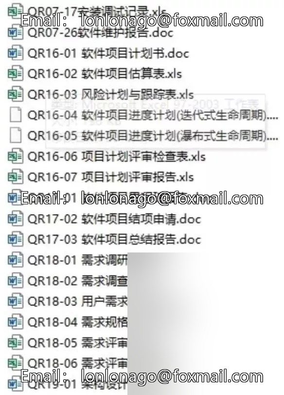
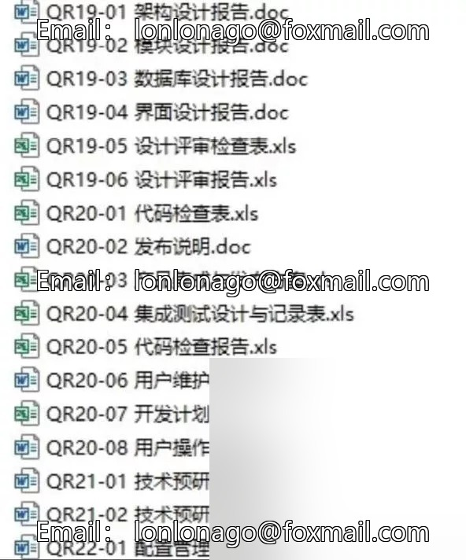
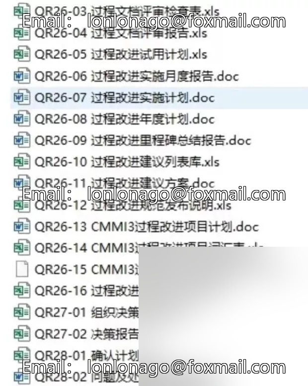
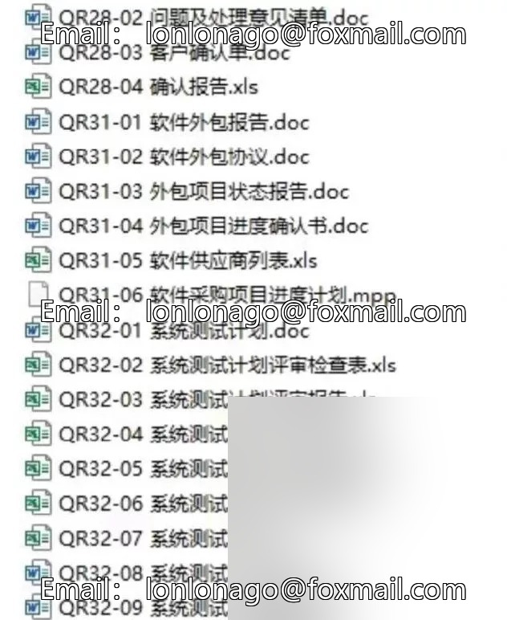
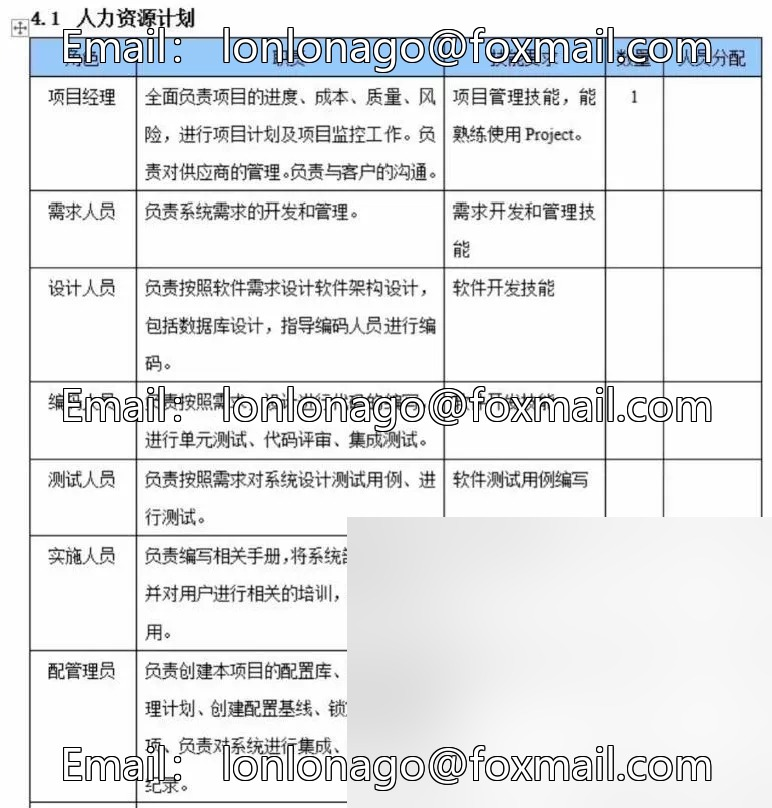

# Requirements document template, complete process specification document for a full set of detailed software development, CMMI standard revision document

## Body

Requirements document template, complete detailed software development full process standard document CMMI standard improved project management template, total 90 files

web-based shipment, can be directly photographed and shipped.

The template covers requirement documentation, full development process standards, CMMI standard improvements and project management, comprising 90 files, along with network delivery.

<!-- AI_ENRICHED -->

## Images

## Payment

Here is a pay link on Stripe ( https://buy.stripe.com/3cs8yP7sY87d0vu9AB ). Please contact me lonlonago@foxmail.com after funding $89, and I will send you a complete data files , thank you!

